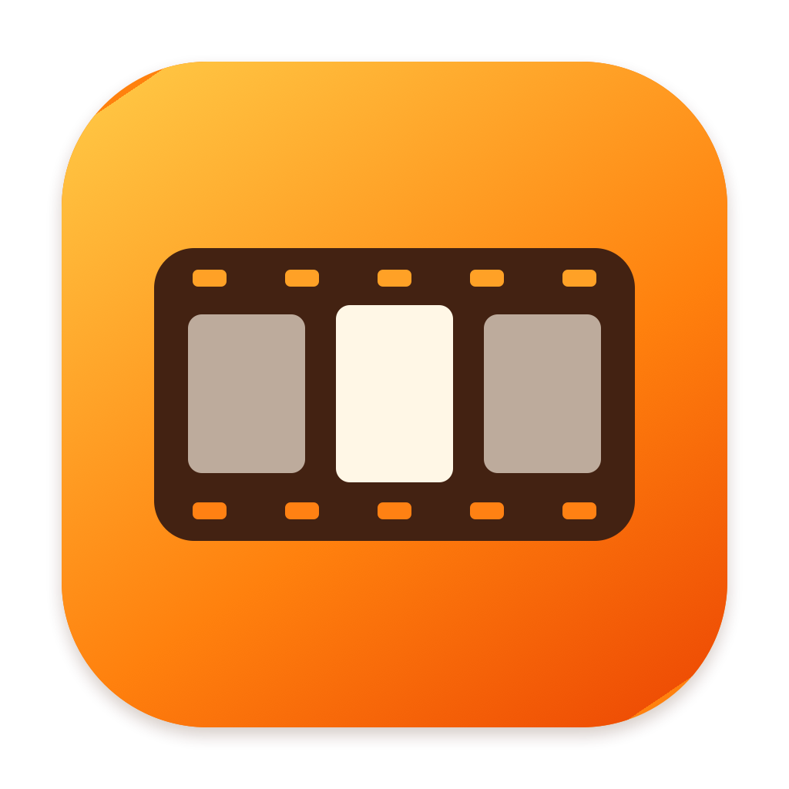
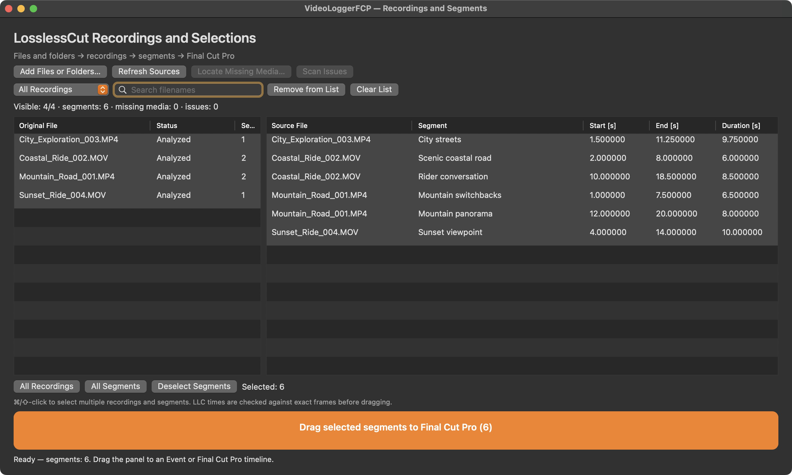

<p align="center"></p>

# VideoLoggerFCP

Turn LosslessCut selections into reusable clips for Final Cut Pro, without copying or transcoding your original media.

VideoLoggerFCP 1.0 is a local macOS AppKit application. Drop in your recordings and LosslessCut projects, select the ranges you need, and drag them directly to an existing Final Cut Pro Event or project timeline. Reuse the same selections in landscape and portrait projects.



*The running English application with synthetic demonstration recordings and six selected ranges. No private media is shown.*

## Why it exists

LosslessCut is useful for reviewing long recordings and naming useful ranges. VideoLoggerFCP brings those selections into Final Cut Pro while keeping the original filenames, source references and frame-aligned ranges. No intermediate video export is required.

**Workflow:** [LosslessCut](https://mifi.no/losslesscut/) → save LLC → import a folder into VideoLoggerFCP → select segments → native Drag & Drop → [Final Cut Pro](https://www.apple.com/final-cut-pro/).

## Features

- Import one or many LLC projects, MP4/MOV recordings, and folders with subfolders.
- Pair projects by `mediaFileName`; show recordings without LLC and missing media.
- Browse recordings and named segments in two panels; select ranges from multiple originals.
- Filter by analyzed, without LLC or missing media; search filenames.
- Remove selected entries or clear the session without touching files. Explicitly add them again to restore them.
- Drag native FCPXML data to an Event or existing timeline. No XML file needs to be saved.
- Preserve source timecode, audio references and frame timing; leave the target project's aspect ratio and resolution to Final Cut Pro.
- Optional CLI export of Keyword Ranges and stringout FCPXML.
- Entirely local processing, with no account, server or paid dependencies.

## Supported media and limits

MP4 and MOV with H.264 or HEVC/H.265, subject to AVFoundation support on the current computer. The engine validates every video presentation timestamp and frame duration. It supports CFR, standard 0/90/180/270° rotation, square pixels and a single supported mono/stereo audio track.

**VFR and irregular timing are rejected. HDR/Dolby Vision, Log and unsupported or incomplete color tags are rejected.** The application never converts HDR to SDR or approximates VFR timing. Rec.709 tags are preserved; completely absent tags are left unspecified. Untagged files are not proof of SDR. See [requirements](REQUIREMENTS.md) and [testing limits](docs/TESTING.md).

There is no claim of full iPhone HDR/VFR compatibility. Real iPhone footage and Final Cut Pro playback need manual verification. JPEG, PNG and other still images are not supported as source media.

## Requirements

- macOS 15 or later; tested locally on macOS Sequoia 15.7.9, Intel x86_64.
- Final Cut Pro for receiving clips; the reported integration environment is Final Cut Pro 12.3.
- Swift 6 / Command Line Tools for building (validated with Swift 6.1.2).
- Original recordings accessible at their existing locations, including external disks.

The included build procedure targets Intel. Apple Silicon distribution is not validated in this release.

## Download and install

Download published builds from [GitHub Releases](https://github.com/chrisowicz/VideoLoggerFCP/releases). The v1.0.0 assets are prepared locally for a later release; this preparation does not publish them.

The prepared release asset is **VideoLoggerFCP-1.0.0-macOS-Intel.zip**, accompanied by a `.sha256` checksum file. Once published, download both files from the official GitHub Releases page, verify the checksum, extract the ZIP and copy **VideoLoggerFCP.app** to `/Applications` using Finder. Double-click the app for daily use.

The application is ad-hoc signed and **not notarized**. A downloaded copy may trigger Gatekeeper; follow [Apple's supported opening guidance](https://support.apple.com/en-gb/102445) only after verifying the source. Do not disable Gatekeeper globally.

## Build from source

```sh
sh Scripts/build-release.sh
open dist/VideoLoggerFCP.app
```

The result is a standalone Release bundle at `dist/VideoLoggerFCP.app`. Copy it to `/Applications` in Finder and open it normally; daily use does not require Terminal. The app does not depend on the build directory after packaging.

This build uses an ad-hoc signature. It is **not notarized** and is not signed with a paid Apple Developer identity. Downloaded copies may be blocked by Gatekeeper; follow Apple's supported opening procedure only after verifying the source. See [build and installation](docs/BUILDING.md).

## Languages

The interface supports **English and Polish**. English is the development language and fallback.
macOS chooses the first supported language in your ordered preferences: for example, German → Polish → English selects Polish, while German alone falls back to English.

To choose a language for this app only, open **System Settings → General → Language & Region → Applications**, add VideoLoggerFCP and select English or Polish. Use the updated application bundle (replace older installed copies first), then quit and reopen it after changing the language. There is no custom language switch. Filenames, LLC segment names, paths and technical identifiers are never translated.

## Use

1. Drop LLC/MP4/MOV files or folders from Finder into the window, or choose **Add Files or Folders…**.
2. Select recordings on the left, then segments on the right with Command/Shift-click.
3. Wait for **Ready**. Media metadata is inspected only for selected sources.
4. Drag the drag panel beneath the tables to an existing Event or open Final Cut Pro timeline.
5. Reuse the selection in another project. Choose **Leave files in place** in Final Cut Pro and verify the original media references.

**Remove from List** removes selected session entries; **Clear List** clears the entire session. Delete/Backspace acts on recordings only when their table has focus. Changing a filter clears the segment selection and prepared drag payload. Refresh does not restore removed entries; explicitly adding the relevant file or folder does.

A missing recording can be located with **Locate Missing Media…**. Relinking is held in memory and never rewrites LLC. Session state is not persisted. See the [usage and FCP verification guide](docs/USAGE.md).

## Screenshots

The screenshot above is a real application-window capture, not a mockup. [Capture provenance and reproduction instructions](docs/images/README.md) describe the synthetic dataset and verification.

## Optional CLI

```sh
swift run videologger /path/to/session.llc
swift run videologger /path/to/session.llc --event-name "Interview & B-roll"
swift run videologger /path/to/session.llc --stringout
swift run videologger /path/to/session.llc --media /path/to/original.MOV \
  --output /path/to/session.fcpxml
```

Default output is beside LLC: `<name>.fcpxml` or `<name>-stringout.fcpxml`. Existing files are not overwritten. Event names do not guarantee merging or deduplication in Final Cut Pro. Repeated imports or drops can create additional clips and keyword collections.

## Development and validation

```sh
swift test --disable-xctest
```

Tests use synthetic projects and tiny generated movies, with no private multi-gigabyte recordings. Optional real-media and Apple DTD checks are documented in [TESTING.md](docs/TESTING.md). Automated XML validation is separate from a real Final Cut Pro import.

For preparing the ZIP/checksum and later uploading release assets, see [RELEASING.md](docs/RELEASING.md).

Localization details and verification are in [LOCALIZATION.md](docs/LOCALIZATION.md).

See [ARCHITECTURE.md](ARCHITECTURE.md), [REQUIREMENTS.md](REQUIREMENTS.md) and the [1.0 release report](docs/RELEASE_REPORT.md).

## License and independence

[MIT License](LICENSE). Copyright © 2026 Krzysiek Wandachowicz — [wandachowicz.com](https://wandachowicz.com). The original icon is covered by the same license.

VideoLoggerFCP is an independent project, not affiliated with or endorsed by Apple or the creator of LosslessCut. Final Cut Pro and macOS are Apple trademarks; LosslessCut is a separate project.
